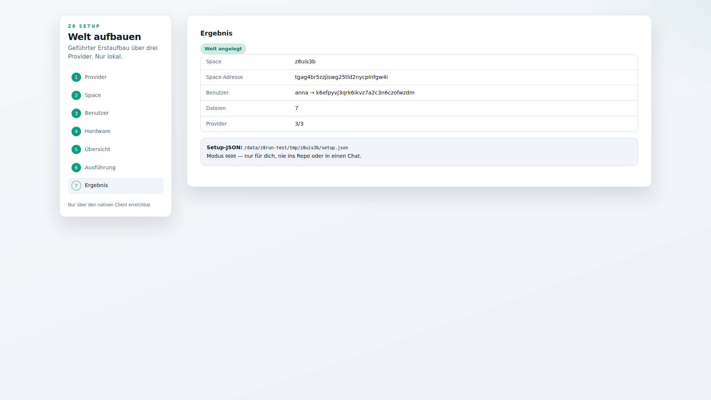
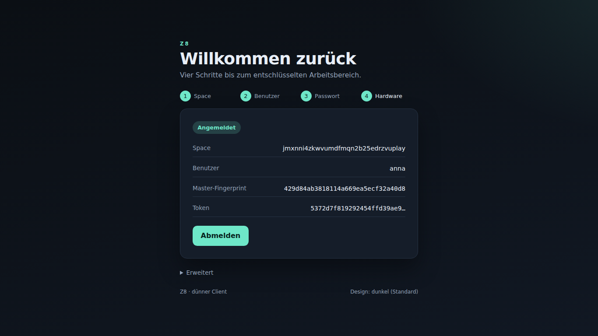

# Z8 benutzen: Setup → Login → Proxy → Apps

Diese Anleitung beschreibt den Weg von einem neuen Linux-Rechner bis zur
ersten eigenen App. Alle Schritte laufen lokal; nach außen geht nur der
Modell-Slot bzw. S3.

## 1. Voraussetzungen

- Linux x86_64, Rust-Toolchain (rust-toolchain.toml), `z8run`-Binary.
- Drei S3-Provider (Linode, Impossible-Cloud, DigitalOcean) mit je einem
  Schlüsselpaar und Bucket-Rechten.
- Provider-Config (NIE ins Repo): `/etc/z8run/s3-multi-providers.json`,
  Modus 0640, Eigentümer root:z8run.

## 2. Welt einrichten (Setup-Engine)

```bash
z8-setup health --providers-config /etc/z8run/s3-multi-providers.json \
  --bucket MEIN-BUCKET --create-buckets
z8-setup init --space meinspace --user anna:'WUNSCHPASSWORT' \
  --providers-config /etc/z8run/s3-multi-providers.json \
  --bucket MEIN-BUCKET --prefix dev/ \
  --key-dir /data/z8run/setup-keys/meinspace \
  --out /root/meinspace-setup.json
```

Die Ausgabe nennt Space-Adresse, User-Adressen und Dateien. Das
Setup-JSON enthält die Setup-PEMs → 0600 aufbewahren, nie teilen.
Der gleiche Vorgang ist als Flow `Z8-Setup` im Canvas verfügbar.

### 2a. Setup-Wizard (nur lokal, Desktop)

Der native Client startet mit `Z8_DESKTOP_TCP=1` einen Loopback-Listener.
Dort liegt `/setup-ui/` — über die 443-Front ist der Pfad bewusst 404
(„Setup-UI nur lokal“). Der Wizard führt in 7 Schritten durch dieselbe
Engine wie `z8-setup init`:

1. Provider-Config (nur der **Pfad**, der Inhalt wird nie gelesen/geloggt),
   Bucket, Prefix, Quorum.
2. Space-Name.
3. Benutzer + Passwörter.
4. Hardware-Keys: Anzahl, Key-Verzeichnis (PEMs entstehen dort, 0600).
5. Übersicht (was angelegt wird).
6. Ausführung mit Live-Log der Engine.
7. Ergebnis; das Setup-JSON liegt unter dem gewählten Pfad (0600).

Ein zweiter Lauf auf derselben Welt verweigert die Engine
(„Welt bereits initialisiert“) — der Wizard zeigt das als Dialog.



## 3. Login

### Login-Wizard (Login-UI)

`/login-ui/` ist eine statische Seite (auch als Datei lauffähig), die im
embed-ui des nativen Clients mitgeliefert wird. Sie ist ein dünner Client:

1. **Space** (B2B-Space-Adresse)
2. **Benutzer**
3. **Passwort**
4. **Hardware-Key** (PEM + KEM-Datei) oder **Passkey** über
   `navigator.credentials.get` (Assertion wird als Parameter an den Kern
   weitergereicht; der HW-Shard wird lokal im Worker geöffnet).

Die Seite holt sich Hashdatei + HW-Shards über
`/login-ui/v1/world` (Schlüssel bleiben serverseitig in der S3-Config) und
führt den `/3`-Login im WASM-Kern aus. Fehler (falsches Passwort, falsche
Space-Adresse, abgelehnter Hardware-Key) erscheinen **inline**, nie als
Alert. Design folgt hell/dunkel dem System; ohne Systeminfo ist **dunkel**
der Standard. Abmelden löscht Token/Session und beendet den Kern-Worker.



### Native/WebAuthn-Endpunkte

- Browser: Login-Seite öffnen, Space + Benutzer + Passwort + Hardware-PEM
  (Dev) bzw. Passkey-Assertion eingeben. Der Browser liest die
  `/3`-Hashdatei und die HW-Shards aus S3, öffnet Passbox und HW-Box
  (hybrid) und hält den Master nur im RAM.
- Nativ/WebAuthn: `POST /hook/<flow>/challenge` → Assertion bauen →
  `POST /hook/<flow>/login` mit Passwort, Assertion und lokal geöffnetem
  `shamir_hw`. Antwort enthält `proxy_token`.
- Falsches Passwort, falsche/fehlende Assertion, Replay oder fremde Origin
  werden mit 401 abgewiesen.

## 4. Im entschlüsselten Proxy arbeiten

Mit `proxy_token` ruft die UI/CLI den Proxy über `/proxy/v1/...` auf:
Session prüfen (`GET /proxy/v1/session`), DB lesen/schreiben, Apps
aufrufen. Der Proxy hält den Master nur im RAM und öffnet den DB-Scope.
`POST /proxy/v1/session/logout` tötet Token + Session sofort (danach 401).

## 5. Apps bauen

Im Canvas einen Flow anlegen, Standard-Nodes verbinden und als App
exportieren (`z8-export`). Apps laufen in der Engine bzw. im Browser-Worker
(wasmi). Für Datenbanken den `db-query`/`db-write`-Pfad nutzen; der
DB-Schlüssel wird aus dem Master abgeleitet und nie gespeichert.

## 6. Grenzen

- `Argon2IDHashDatei/2` und der alte kv-login-Dienst sind entfernt.
- Kein Shared-Space, keine gemeinsamen Datenbanken (D6).
- Provider-Ausfall: ein Provider darf ausfallen (Quorum 2/3). Zwei
  Ausfälle = fail-closed (kein Schreiben, keine stille Teilwelt).
- Keys/Backups gehören nicht ins Repo und nicht in Logs.
